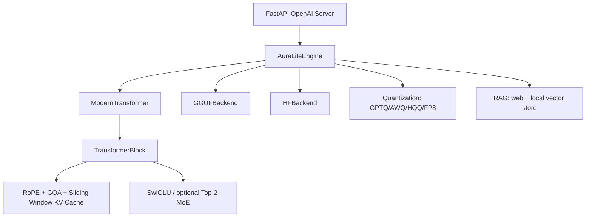

# 🌟 AuraLite AI

[](https://github.com/AlexanderNyr/AuraLite-AI/actions/workflows/ci.yml)


[Quickstart](https://github.com/AlexanderNyr/AuraLite-AI/blob/main/docs/quickstart.md) · [FAQ](https://github.com/AlexanderNyr/AuraLite-AI/blob/main/docs/faq.md) · [Quantization](https://github.com/AlexanderNyr/AuraLite-AI/blob/main/docs/quantization.md)

**AuraLite AI** is a lightweight, educational Large Language Model (LLM) implemented using **PyTorch**. It is designed to demonstrate the inner workings of the Transformer architecture (the foundation of models like GPT-4) in a way that is accessible and runnable on consumer hardware.

## ⚡ Quickstart

```bash
pip install 'auralite-ai[serve]'     # Python 3.11–3.14 (PyPI from 2.7.0; in a clone: pip install -e '.[serve]')
auralite train --text corpus.txt --model model.pt
auralite generate --model model.pt --prompt "Once upon a time" --length 80
auralite serve --model model.pt      # OpenAI-compatible API on http://127.0.0.1:8000
auralite export --model model.pt     # model.pt2 — runs with plain PyTorch (torch.export)
auralite image-train --images photos/ --preset small --model gen.pt   # your own image generator
auralite image-train --images photos/ --type gan --preset tiny --model gan.pt   # or flow / gan
auralite image-generate --model gen.pt -n 16 --out grid.png
auralite image-eval --model gen.pt --images photos/          # quality score (SWD), no pretrained net
auralite tokenizer train --text corpus.txt --vocab-size 4096 --out tok.json   # only the tokenizer
auralite train --text corpus.txt --tokenizer tok.json --model model.pt        # or a tokenizer.json
auralite-gui                         # desktop app: train, chat, quantize, evaluate, export
```

```python
from auralite import AuraLiteEngine

engine = AuraLiteEngine()
engine.train(open("corpus.txt", encoding="utf-8").read(), {"epochs": 3})
print(engine.generate("Once upon a time", length=80))
```

Everything lives in one package, `auralite` (`auralite.engine`, `auralite.server`,
`auralite.quantization`, `auralite.export`, …). Extras: `[serve]` server, `[hf]`
Hugging Face + LoRA, `[export]` ONNX, `[torchao]` future-proof INT8, `[gguf]`
llama.cpp — see *Installation* below.


## ⚡ v2.6 Modern Training Stack

Three upgrades straight from 2024–2025 frontier practice:

- **QK-norm** (`use_qk_norm`) — per-head RMS normalization of queries/keys **before** RoPE. Popularized by ViT-22B (Dehghani et al., 2023) and now standard in OLMo-2, Gemma-2/3, Qwen3 and GLM. Caps attention-logit growth and stabilizes training at higher learning rates.
- **Muon optimizer** (`optimizer="muon"`) — **M**oment**U**m **O**rthogonalized by **N**ewton–Schulz (Keller Jordan et al., 2024; used in Moonlight / Kimi K2 and every current speedrun). The hidden 2-D weight matrices of the transformer body are updated with a Newton–Schulz-orthogonalized momentum step at a shape-aware LR (`match_rms_adamw` mode transfers AdamW-tuned LRs). Embeddings, norm scales and an untied LM head automatically stay on a companion AdamW group (`split_parameters_for_muon`). AdamW remains available (`optimizer="adamw"`) and is auto-selected for LoRA runs.
- **2.12: one default recipe, Muon + QK-norm + WSD + early stopping,** for `train()`, the GUI and the CLI alike (`train()` and the CLI used AdamW without QK-norm). With early stopping on a 100 KB text Muon + QK-norm reached 2.196 bits per byte against 2.308 for AdamW + QK-norm (three seeds); on a megabyte it was 0.3 % better per step and ties at equal time, because a Muon step costs ~21 % more on a CPU. Numbers: [docs/training.md](https://github.com/AlexanderNyr/AuraLite-AI/blob/main/docs/training.md) § 8. `"optimizer": "adamw"` gives the fastest steps.
- **2.13: honest validation, full-speed generation on every thread.** A new BPE tokenizer is fitted without the validation text (2.12 learned the held-out words too, which made validation up to 9 % optimistic for large vocabularies); an early stop ends with a short learning-rate decay (1.2 % better on tinyshakespeare, three seeds); every generation forward pass runs on one compute thread, so the server and the GUI decode as fast as the main thread. Numbers: [docs/training.md](https://github.com/AlexanderNyr/AuraLite-AI/blob/main/docs/training.md) § 6, 8, 10 and [docs/engine.md](https://github.com/AlexanderNyr/AuraLite-AI/blob/main/docs/engine.md) § 10.
- **WSD scheduler** (`lr_schedule="wsd"`, now the default) — **W**armup-**S**table-**D**ecay trapezoidal schedule (MiniCPM 2024, DeepSeek-V3-style multi-phase training). Linear warmup → constant LR until `wsd_stable_ratio` (default 80%) → short decay (`cosine` / `linear` / `sqrt`) to `wsd_min_lr_ratio`. Matches or beats cosine convergence and lets you branch a decay run from any stable-phase checkpoint. Pure cosine remains available via `lr_schedule="cosine"`.

```python
engine.train(text, {
    "use_qk_norm": True,        # QK-norm per attention head
    "optimizer": "muon",        # Muon for hidden matrices
    "muon_lr": 0.02,
    "lr_schedule": "wsd",       # Warmup-Stable-Decay (default)
    "wsd_stable_ratio": 0.8,
    "wsd_decay": "cosine",
    ...
})
```


## 🚀 v2.4 Production-Grade Architecture Update

AuraLite now keeps the original educational single-file entry points **and** adds a production-oriented package layout:



### New high-impact capabilities

- **LLaMA-compatible RoPE**: `rotate_half` formulation, exact inverse-frequency formula, and improved Linear / Dynamic-NTK / YaRN scaling.
- **Hardened GQA KV-cache**: per-layer caches keep unrepeated KV heads, support sliding-window eviction, and optional FP8/INT8 cache storage.
- **Research architecture flags**: `sliding_window`, `use_moe`, `num_experts`, `use_flex_attention`, `kv_cache_dtype`, `tie_word_embeddings`.
- **Untied input/output embeddings (default)**: the token embedding (read/context) and the LM head (write/classification) are two mathematically distinct layers, kept as **independent parameters by default**. Sharing one matrix forces it to both cluster synonyms (input) and separate them (output); the opposing gradients partially cancel and slow convergence. Legacy weight tying remains an explicit opt-in via `tie_word_embeddings=True`, `model.tie_weights()` / `model.untie_weights()`.
- **One package** (2.7.0): everything is importable from `auralite` — `from auralite import AuraLiteEngine`, `auralite.engine.layers`, `auralite.engine.model`, `auralite.server`, … The flat names of 2.6 (`model_engine`, `server`, …) still work inside a source checkout until 3.0, with a `DeprecationWarning`.
- **Serving**: `auralite/server/openai_server.py` exposes `/v1/completions`, `/v1/chat/completions`, and `/health`.
- **RAG upgrade**: optional persistent vector store, semantic chunking, HyDE query expansion, and citation-style `[source: ...]` context.
- **Quantization upgrade**: HQQ, optional FP8, AWQ alpha/clip grid search, Cholesky-stabilized GPTQ.

### Example: train with modern options

```python
from auralite import AuraLiteEngine

engine = AuraLiteEngine()
engine.train(text, {
    "tokenizer": "bpe",
    "bpe_vocab_size": 4096,
    "d_model": 768,
    "n_heads": 12,
    "n_kv_heads": 4,
    "n_layers": 12,
    "d_ff": 2048,
    "seq_length": 2048,
    "sliding_window": 1024,
    "rope_scaling": {"type": "yarn", "factor": 4.0, "original_max_position_embeddings": 2048},
    "use_moe": False,
    "use_compile": True,
})
engine.save_model("auralite-v24.pt")
```

### Example: serve OpenAI-compatible API

```bash
AURALITE_MODEL=auralite-v24.pt uvicorn auralite.server.openai_server:app --host 0.0.0.0 --port 8000
# or: auralite serve --model auralite-v24.pt
```

## 🚀 Key Features
- **🖼️ From-Scratch Image Generator**: the **Image** tab, `auralite image-train` / `auralite image-generate` and `ImageGenEngine` train your **own** image generator on a folder of images — **no pretrained weights**. 2.14.2: three model types — denoising **diffusion**, **flow matching** (rectified flow, the objective of Stable Diffusion 3: a 2.5× lower FID than diffusion at the same budget on MNIST) and a modern **GAN** after R3GAN (relativistic loss with R1 + R2, ResNet generator/discriminator without normalisation, EMA generator, truncation trick, optional DiffAugment with ADA's adaptive probability; **one network call per image**) — plus a quality score that needs no pretrained network (`auralite image-eval`, the patch sliced Wasserstein distance of ProGAN) and progress for every stage on one bar. A compact **self-attention U-Net** with **presets** (Tiny/Small/Medium/Large), **ε / x0 / v-prediction**, **linear / cosine / sigmoid** noise schedules (rescaled so they end in pure noise for any step count), **Min-SNR-γ**, **EMA** with warmup, **AMP**, gradient accumulation & checkpointing, channels-last on CPU, warmup+cosine LR, h-flip augmentation, seeding, continue-training and autosave. **Class-conditional** training from sub-folders with **classifier-free guidance**, a deterministic **held-out validation loss** with early stopping, and **DPM-Solver++(2M)** (good samples in 10–20 steps) next to DDIM / DDPM. Live loss/val plot, preview grid, seeded output, save samples (+ grid), `.pt` / `.safetensors` checkpoints. 2.10 made a training step 1.5–2.6× faster on CPU and fixed the noise schedule, EMA and continue-training — see [docs/image.md](https://github.com/AlexanderNyr/AuraLite-AI/blob/main/docs/image.md). Requires the optional `Pillow` dependency.
- **PyTorch Engine**: Professional-grade tensor operations, autograd and optimization.
- **GGUF / llama.cpp Inference**: Load `.gguf` models directly (quantized Llama/Mistral/Qwen/etc.) via `llama-cpp-python` for generation, streaming, batch prompts, Thinking Mode and web-context prompting.
- **Modern Transformer Architecture (LLaMA-style)**: A decoder-only transformer with **RMSNorm** (pre-norm), **RoPE** (Rotary Position Embeddings), **SwiGLU** feed-forward, optional **GQA** (Grouped-Query Attention), **untied input/output embeddings by default** (optional weight tying via `tie_word_embeddings=True`) and a **KV-cache** for fast generation.
- **Flash Attention**: Uses PyTorch `scaled_dot_product_attention` (fused / memory-efficient kernels) instead of a hand-rolled softmax.
- **BPE Tokenizer (built-in)**: A self-contained mini-BPE trained on your corpus (configurable vocab size), switchable to classic character-level tokenization. BPE dramatically improves text quality — the model learns sub-words instead of single letters.
- **Validation Split**: A held-out fraction of the text is evaluated every epoch, spread over the whole split. **Early stop** (on by default since 2.12, 3 epochs) ends a run whose val loss stopped improving and keeps the best epoch's weights; since 2.13 it first decays the learning rate for up to two epochs. A new BPE tokenizer never sees the validation text (2.13).
- **Ending a run well (2.12)**: **Stop** (Ctrl+C in the CLI) finishes with a short learning-rate decay instead of cutting the run at the peak learning rate, a second press stops at once; a **Time limit** sizes the schedule so the decay ends on time ([docs/training.md](https://github.com/AlexanderNyr/AuraLite-AI/blob/main/docs/training.md) § 9).
- **torch.compile (optional)**: Compiles the training step before the first batch (16–20 s on CPU with an empty cache) and falls back to eager if that fails. On a 2-thread CPU it no longer beats the eager loop, so measure before relying on it.
- **Continue Training**: Fine-tune the model currently in memory (trained or loaded) on a new file instead of starting from scratch.
- **Autosave**: Optional checkpoint autosave every N epochs — never lose a long run.
- **Hardware Acceleration**: Automatic detection and usage of **NVIDIA CUDA** (GPU) for training and generation, with a seamless fallback to **CPU**.
- **Full CPU Multithreading**: Automatically configures PyTorch (and the OpenMP/MKL backends) to use **all available CPU cores**. Batches are gathered in the training process (one indexing operation each), so no worker processes are started.
- **Mini-Batch Training**: Training runs on shuffled mini-batches of non-overlapping windows (configurable **Batch Size**); one epoch is one pass over the text, with a fresh window offset every epoch.
- **Advanced GUI**: A comprehensive control panel built with `tkinter` that allows real-time interaction with the model.
- **Hyperparameter Tuning**: Full control over the AI's "brain" directly from the interface:
  - **Learning Rate**: Controls how fast the model adapts to new data.
  - **Epochs**: Determines how many times the model studies the dataset.
  - **Model Dimension (D_Model)**: Sets the size of the internal vector representations.
  - **Feed-Forward Dimension (D_FF)**: Controls the capacity of the processing layers.
  - **Heads (N_Heads) / Layers (N_Layers)**: Shape of the attention mechanism and network depth.
  - **Context Window (Seq Length)**: Defines how many previous characters the AI considers when predicting the next one.
  - **Batch Size**: Number of samples processed per optimizer step. Larger values use more memory but better utilize multiple CPU cores / the GPU.
  - **Dropout / Grad Clip**: Regularization and training-stability controls.
- **Sampling Controls**: Temperature, **Top-K**, **Top-P (nucleus)** and **Repetition Penalty** for generation.
- **Dense Next-Token Loss**: The loss is computed over **every position** of the context window (nanoGPT-style), making training far more sample-efficient than last-position-only prediction.
- **Tabbed GUI**: Three clean tabs — 🏋️ Training (hyperparameters, tokenizer options, loss history), ✨ Generation (sampling + prompt + output), 💾 Model (save / load + full model info).
- **🧠 Thinking Mode (NEW)**: Two-pass generation — the model first free-writes a higher-temperature *draft* ("thoughts"), then the final answer is generated conditioned on that draft (self-conditioning). No retraining needed; works with any existing checkpoint. The GUI shows the thinking block and the final answer separately.
- **🌐 Web Search / mini-RAG (NEW)**: Optional DuckDuckGo search (no API key, stdlib-only) — top result snippets are injected into the prompt as retrieval context before generation. Can be combined with Thinking Mode. If the search fails (offline), generation gracefully continues without it.
- **⚡ Model Quantization (NEW v2.2)**: Comprehensive quantization toolkit with 6 methods: Dynamic INT8, Static INT8, QAT, GPTQ (INT2/3/4/8), AWQ (INT4/INT8), Half Precision (FP16/BF16). Dedicated GUI tab with benchmarking, comparison tables, and one-click quantization. Supports packed low-bit storage, Hessian-based rounding, activation-aware weight protection, and fake-quantize STE for training.
- **Custom Training**: Upload any `.txt` file to teach the built-in AuraLite `.pt` model specific styles, languages, or fictional worlds.
- **External GGUF Models**: Open `.gguf` files from the Model tab and use them immediately for inference. GGUF files are inference-only in AuraLite; train/fine-tune with AuraLite’s native `.pt` checkpoints.
- **Interruptible Training**: Ability to stop training at any point and preserve the learned weights for immediate testing.
- **Gradient Checkpointing**: Trade compute for memory — enables training of larger models on consumer GPUs. Toggle in the Training tab.
- **💬 Chat / Instruction Mode**: Dedicated chat tab with system/user/assistant roles, multiple templates (ChatML, Llama-2, Mistral, Gemma, Phi), conversation history, and **real-time token streaming**.
- **📏 Long generations stay coherent (2.11)**: generation attends to the newest `seq_length` tokens, the distances the model was trained on. Before 2.11 everything past the trained length turned into noise (held-out loss 3.97 against 1.48 at positions 256–511 of a model trained on 64). The KV cache stays bounded and long prompts are prefilled in chunks. `--full-context` / `engine.set_context_window("full")` restores the old behaviour — see [docs/engine.md](https://github.com/AlexanderNyr/AuraLite-AI/blob/main/docs/engine.md#9-context-length).
- **🔄 RoPE scaling (linear / NTK / YaRN)**: for continued training on longer windows and for imported models. On its own it does not let a model read past the length it was trained on (measured in docs/engine.md § 9); `continue_training` with a longer `seq_length` extends a model (docs/training.md § 7).
- **🌙 Dark Theme**: Toggle available in the header.
- **☁️ Hugging Face Hub Integration**: Push/pull models and LoRA adapters to/from the Hub.
- **📊 Model Evaluation**: Built-in evaluation using `lm-evaluation-harness` (ARC, MMLU, GSM8K, etc.).

## ✅ Feature status: implemented / limited / opt-in (v2.6.5)

Honest status of the features that are easy to over-promise. Everything marked
"implemented" has a regression test in `tests/` (see `tests/test_improvements_v265.py`).

| Feature | Status | Notes |
|---|---|---|
| Speculative decoding (`generate_speculative`) | **implemented** (2.8: rollback) | Prompt-lookup or draft-model drafting, batched verification, exact speculative sampling: token-identical to `generate()` in greedy mode, distribution-matched at T>0. 2.8 rolls the KV cache back after a rejected draft instead of re-reading the whole context, and a draft model keeps its own cache — measured ×2.2 (prompt lookup) to ×6.7 (rejected drafts) faster than 2.7, see [docs/engine.md](https://github.com/AlexanderNyr/AuraLite-AI/blob/main/docs/engine.md). `stats=` reports drafted/accepted/acceptance_rate/rollbacks. |
| KV cache | **implemented** (2.8) | Preallocated, in-place, truncatable (`auralite/engine/kv_cache.py`). Sliding-window models are correct for prompts longer than the window (2.7 was not); `kv_cache_dtype` fp16/bf16 really stores half precision, int8/fp8 keep per-(token, head) scales written once (0.28× of fp32). |
| Sampling | **implemented** (2.8) | Repetition, presence and frequency penalties, temperature, top-k, min-p, top-p — the same distribution as 2.7, ×1.8–7.4 faster per step (`auralite/engine/sampling.py`). The server honours OpenAI's `presence_penalty` / `frequency_penalty`. |
| Training loop | **implemented** (2.9) | An epoch is one pass over the text (`sample_stride`; 2.8 epochs were `seq_length` passes), validation covers the whole held-out split (the 2.8 estimate read its first ~1,700 tokens and was 8–12 % too optimistic), `early_stopping_patience` / `restore_best_weights`, and `train()` returns a summary. Unknown parameters are reported instead of silently ignored. A CPU training step is 8–14 % faster (closed-form RMSNorm backward, cheaper dropout), see [docs/training.md](https://github.com/AlexanderNyr/AuraLite-AI/blob/main/docs/training.md). |
| Image model types: flow matching, GAN | **implemented** (2.14.2) | `model_type` (GUI *Model Type*, `image-train --type flow\|gan`). Flow matching trains the diffusion U-Net with rectified flow (logit-normal times; DPM-Solver++ / Euler / Heun): MNIST-16 classifier-FID 74.4 against 187.5 for diffusion at the same 1,570 steps. The GAN (R3GAN-style: RpGAN + R1/R2, inverted-bottleneck ResNets with fix-up init, EMA generator, projection discriminator for classes, optional DiffAugment/ADA) scored 156 (mean of three seeds) and samples 1,000 images in 0.2 s against 27 s. `auralite image-eval` / `evaluate()` / *📏 Measure Quality*: patch SWD with the real-vs-real floor. Image runs report decoding, building, batches and validation as stages; the GUI shows them on one bar ([docs/image.md](https://github.com/AlexanderNyr/AuraLite-AI/blob/main/docs/image.md) § 10–15). |
| Image generator | **implemented** (2.10) | Attention now reaches the fused SDPA kernels (it ran the math fallback), channels-last on CPU and automatic 32-channel heads: a training step is 2.6× (*Tiny*) / 1.5× (*Small*) faster. Linear/sigmoid schedules are rescaled to end in pure noise, EMA warms up, continue-training uses the new settings. DPM-Solver++(2M), class-conditional training with classifier-free guidance, held-out validation + early stopping, `auralite image-train` / `image-generate`. Measured on MNIST with a classifier-FID, see [docs/image.md](https://github.com/AlexanderNyr/AuraLite-AI/blob/main/docs/image.md). |
| FlexAttention (`use_flex_attention=True`) | **implemented, opt-in** | Real `torch.nn.attention.flex_attention` path (compiled once on first use) used for sliding-window/causal prefill; verified to match SDPA (≤1e-4). Falls back to SDPA automatically when the runtime can't compile it. |
| GGUF evaluation | **implemented** | `.gguf` models are scored directly through llama.cpp: perplexity / rolling log-likelihood in `n_ctx-1` windows (`engine.gguf_perplexity`, `gguf_loglikelihood_rolling`). Needs `llama-cpp-python` with `logits_all` support; `evaluation.py` also tries the `lm_eval` llama.cpp backend first. |
| Checkpoint safety | **implemented** | `.pt` files load with `weights_only=True`; pre-2.6.5 checkpoints work through a scoped numpy allowlist. `.safetensors` (weights + JSON metadata, no pickle) is supported for text and image models. `AURALITE_UNSAFE_LOAD=1` / `allow_unsafe=True` is an explicit opt-in for trusted old files. |
| Agent tools (`calculate`, sandbox) | **implemented, limited** | `calculate` is an AST whitelist (no `eval`), the sandbox runs in a subprocess with a sanitized environment, resource limits and tree-kill. OS-level isolation is **not** provided — a determined payload can still open sockets (documented limitation). |
| Quantization backends | **torch.ao + torchao, both tested** | `AURALITE_QUANT_BACKEND=auto` (default, 2.7.0) uses PyTorch's deprecated `torch.ao.quantization` while it exists — its eager CPU INT8 kernels are the fastest (≈1.9× prefill vs fp32; torchao's weight-only INT8 is slower than fp32 without `torch.compile`) — and switches to torchao automatically once it is gone (`pip install 'auralite-ai[torchao]'`). `=torchao` forces INT8 weight-only through `torchao.quantize_` (CI runs it against torchao 0.18). Reported sizes now count the packed INT8 weights: dynamic INT8 used to claim ~20× compression. See `auralite/quantization_backends.py`, `auralite info --backends`, [docs/quantization.md](https://github.com/AlexanderNyr/AuraLite-AI/blob/main/docs/quantization.md). |
| Export: `.pt2` / ONNX / TorchScript / Hugging Face | **implemented** (2.7.0: `torch.export`) | `auralite export --model m.pt` writes a `.pt2` `torch.export` program (dynamic batch and length, tokenizer inside, runs with plain PyTorch). ONNX goes through PyTorch's `torch.export`-based exporter (`pip install -e '.[export]'` brings `onnx`, `onnxruntime`, `onnxscript`); the TorchScript exporter is the fallback for opset < 18. TorchScript export still works but is deprecated, as PyTorch deprecated `torch.jit`. Hugging Face export needs `transformers`/`peft`. The `optional-deps` CI job runs the real ONNX/HF paths with `AURALITE_REQUIRE_INTEGRATIONS=1`, so they cannot pass by skipping; `.pt2` round trips run in every test job. |
| OpenAI-compatible server | **implemented, single worker** | API-key auth (`AURALITE_API_KEY`, comma-separated keys, constant-time compare), SSE streaming with graceful shutdown, `/metrics` (Prometheus text format). Single worker is deliberate: engine, KV-cache and rate-limiter live in process memory. |
| Streaming chat text | **implemented** | `generate_chat_streaming()` and `generate_chat()` now produce the same text (leading whitespace of the first piece is trimmed). |
| Batch generation | **implemented** | Mixed-length prompts are grouped by length, identical prompts are deduplicated (a repeated question costs one forward pass). |
| Inference speed | **measured** | `auralite info --bench N --bench-modes --bench-compile` reports decode tokens/s, KV-cache bytes/token for fp32/fp16/int8 (same weights, rebuilt model) and eager vs `torch.compile` prefill. CPU measurement (d512/4L/256): decode 1748 tok/s; `torch.compile` ×1.1–1.7 on prefill (B=4 T=64: 40k→58k tok/s), 0.0× on single-token decode — hence decode stays eager, and `--compile` only speeds up prompts. Kernel cache lives in `$AURALITE_HOME/torch_inductor`. |
| GGUF backends | **implemented** | Two runtimes behind one API: in-process `llama-cpp-python` (tokenisation, generation, perplexity) and a shared `llama-server` (`AURALITE_LLAMA_SERVER_URL` / `load_gguf_model("http://…")`) that keeps one model load per machine. Perplexity is refused on the server backend instead of being approximated, and in-process scores are cached in `$AURALITE_HOME/gguf_ppl_cache.json` (keyed by file identity + n_ctx + corpus hash) — `auralite info --model m.gguf --perplexity --text F`. |
| Training on several computers | **implemented** (2.14) | `auralite cluster-worker MAIN` on the helper computers, `--cluster-workers N` (or the GUI's *Cluster* row, or `cluster_workers` in `train()`) on the main one. Windows and Linux can be mixed. The workers get the text, the settings and the tokenizer from the main computer; every optimizer step is split between all of them (DDP over gloo, CPU), so the result is the model one computer trains. Two processes with one core each trained 1.43 times as fast as one; over a network it pays off with wired Gigabit Ethernet and steps of 0.1 s or more ([docs/training.md](https://github.com/AlexanderNyr/AuraLite-AI/blob/main/docs/training.md) § 12). |
| Your own tokenizer, tokenizer-only training | **implemented** (2.14.1) | `auralite train --tokenizer FILE` (GUI: *Own file*, `tokenizer_path` in `train()`) trains with a file of `auralite tokenizer train`, a Hugging Face `tokenizer.json` with a BPE model (GPT-2, Llama, Mistral, Qwen style), GPT-2 `vocab.json` + `merges.txt` or a checkpoint's tokenizer. AuraLite reads them without the `tokenizers` package and encodes like it (the real GPT-2, Qwen2.5, TinyLlama, SmolLM2 and Phi-2 files: no difference); unsupported components are refused by name. `auralite tokenizer train` / the GUI's *Train tokenizer only* / `train_tokenizer()` train only the tokenizer, with the run's validation split left out. Progress of every stage (tokenizer, tokenizing, epoch, validation) with done/total, speed and time left ([docs/training.md](https://github.com/AlexanderNyr/AuraLite-AI/blob/main/docs/training.md) § 13). |
| Server concurrency | **implemented, correct since 2.12** | Up to `AURALITE_MAX_CONCURRENT` requests (default 4) generate at the same time; more queue for `AURALITE_QUEUE_TIMEOUT` seconds (default 10) and only then get `503` + `Retry-After`; `/metrics` exposes the in-flight gauge. 2.12: every generation owns its KV cache and decode steps interleave under the engine's lock. Up to 2.11 concurrent generations shared one cache and returned corrupted text (20 of 20 in a 4-thread test, also from the GUI's generation and chat tabs). A GGUF model serves one generation at a time. 2.13: decode steps run on one compute thread, so requests decode at main-thread speed (one request 696 instead of 298 tokens/s on 2 vCPU). 2.14: the decode steps of concurrent requests share one forward pass (`AURALITE_MAX_BATCH`, default 4): four streams decode 2.4-2.8 times as fast as one (2.8-3.3 times four in 2.13), and `n` / `logprobs` / `top_logprobs` are served ([docs/engine.md](https://github.com/AlexanderNyr/AuraLite-AI/blob/main/docs/engine.md) § 11, [docs/faq.md](https://github.com/AlexanderNyr/AuraLite-AI/blob/main/docs/faq.md) § 9). |
| Module layout | **implemented** | One import package, `auralite` (2.7.0): the wheel installs nothing else, so no generic top-level names (`server`, `kernels`, …) land in site-packages. `auralite/engine/_legacy.py` is down to the engine itself; layers/model/dataset/tokenizers/optimizers/scheduler/gguf_proxy/safe_io/logging_utils own their code, `auralite.engine.X` resolves every historical name — and `tests/test_module_layout.py` fails if a module turns back into a re-export shim. In a checkout the 2.6 names are deprecated aliases of the same module objects until 3.0 (`auralite/_compat.py`). |
| GUI code layout | **implemented** | `auralite/gui/app.py` holds the app core and `auralite/gui/tabs/*.py` one module per tab (mixins). Start it with `auralite-gui` (installed) or `python gui_app.py` (checkout); `from gui_app import AIApp` still works until 3.0, with a `DeprecationWarning`. |
| GUI session & i18n | **implemented** | `auralite/gui/config.py` persists settings (`$AURALITE_HOME/gui_config.json`), `auralite/gui/session.py` keeps a crash-safe snapshot (atomic write, last corpus/tab restored on start, saved on close). UI strings live in one catalogue, `auralite/gui/i18n.py`. |
| GUI insights | **implemented** | Chat tab plots the last reply's token frequencies and this layer's attention map (`engine.token_frequencies()`, `engine.attention_maps()` → `auralite/gui/visualizations.py`); visible when matplotlib is installed, hidden with an explanatory label otherwise. |
| GUI background work | **implemented** | `auralite/gui/async_ops.TkAsyncBridge` runs blocking functions/coroutines off the Tk thread and delivers results (or errors) back through `root.after`, and is shut down when the window closes. |
| Library logging | **implemented** | No library module prints any more: the engine logs through the `auralite` logger (sub-loggers `auralite.hf`, `auralite.image`, `auralite.export`, `auralite.webtools`), "[AuraLite] …" wording unchanged, INFO visible by default, `$AURALITE_LOG_LEVEL` respected. The CLI keeps the historical UX by pointing that logger at stdout (`--quiet` → CRITICAL, `--log-level` honoured); the GUI console tab shows the same lines because the handler re-resolves `sys.stderr` on every record. The CLI/eval reports and the benchmarks still print — that is their output. |

### Diagnostics

```bash
auralite info --model model.pt --backends        # quantization backend availability
auralite info --model model.pt --bench 128       # tokens/s, weight memory, KV-cache mode
auralite info --model model.pt --quiet           # no progress/library noise
auralite train --text corpus.txt --params p.json  # engine logs go to stdout
AURALITE_LOG_LEVEL=WARNING auralite generate ...  # or silence INFO library lines
AURALITE_AGENT_MAX_ITERATIONS=12 AURALITE_AGENT_TOOL_TIMEOUT=30 auralite-gui
```

## 📚 Documentation

| File | Contents |
|---|---|
| [docs/quickstart.md](https://github.com/AlexanderNyr/AuraLite-AI/blob/main/docs/quickstart.md) | install → train → generate → serve → GUI, in five minutes |
| [docs/faq.md](https://github.com/AlexanderNyr/AuraLite-AI/blob/main/docs/faq.md) | "why isn't it faster?": how to measure, `torch.compile` prefill-vs-decode, KV-cache dtypes, quantization expectations, corpora |
| [docs/engine.md](https://github.com/AlexanderNyr/AuraLite-AI/blob/main/docs/engine.md) | inside the native engine: decode loop, KV cache, sampling, speculative decoding, MoE, BPE pre-tokenizer, context length, the 2.13 compute thread — with measured numbers |
| [docs/training.md](https://github.com/AlexanderNyr/AuraLite-AI/blob/main/docs/training.md) | the training loop: what an epoch is, how validation is measured (honestly since 2.13), early stopping, speed, choosing a tokenizer, your own tokenizer and tokenizer-only training (2.14.1), the default recipe and how a run ends (Stop, Ctrl+C, time limits) — with measured numbers |
| [docs/image.md](https://github.com/AlexanderNyr/AuraLite-AI/blob/main/docs/image.md) | the image generator: speed, schedule/EMA fixes, validation, DPM-Solver++, classes and guidance — with measured 2.9 → 2.10 numbers; 2.14.2: flow matching, the GAN, the patch-SWD quality score and the progress stages, measured on MNIST |
| [docs/quantization.md](https://github.com/AlexanderNyr/AuraLite-AI/blob/main/docs/quantization.md) | every method (dynamic/static INT8, QAT, GPTQ, AWQ, HQQ, half), what it actually buys, GGUF paths |
| [docs/releasing.md](https://github.com/AlexanderNyr/AuraLite-AI/blob/main/docs/releasing.md) | for maintainers: tag → verified GitHub Release, GHCR image and (opt-in, tokenless) PyPI upload |
| [ARCHITECTURE.md](https://github.com/AlexanderNyr/AuraLite-AI/blob/main/ARCHITECTURE.md) | module map and engine data flow |
| [CHANGELOG.md](https://github.com/AlexanderNyr/AuraLite-AI/blob/main/CHANGELOG.md) | what changed in v2.6.5 and why |

## 🛠 Technical Specifications
- **Framework**: PyTorch (Tensors, Autograd, AMP on CUDA, optional `torch.compile`).
- **Attention**: Multi-Head Self-Attention via PyTorch SDPA (Flash / memory-efficient kernels) with Causal Masking, RoPE and optional GQA.
- **Normalization**: RMSNorm (pre-norm), as used in LLaMA / Mistral / Qwen.
- **Optimizer**: AdamW (betas 0.9/0.95, weight decay) with **cosine LR schedule + linear warmup** and gradient clipping.
- **Input/Output**: Built-in **BPE** tokenizer (recommended) or character-level tokenization; old char-level checkpoints load transparently.

## 📦 Installation & Setup

### Prerequisites
- **Python 3.11 – 3.14.** Python 3.10 reached end-of-life on 2026-10-01; AuraLite 2.6.x was the last series that supported it.
- **NVIDIA GPU** (optional). No CUDA Toolkit is needed — only the driver: on Linux the default `torch` wheel from PyPI already contains CUDA; on Windows pick the CUDA build on [pytorch.org](https://pytorch.org/get-started/locally/).

### Install
```bash
git clone https://github.com/AlexanderNyr/AuraLite-AI.git && cd AuraLite-AI
pip install -e .              # core: torch, numpy, matplotlib (training, generation, GUI)
pip install -e '.[serve]'     # + OpenAI/Ollama-compatible server (FastAPI, uvicorn)
pip install -e '.[hf]'        # + Hugging Face models and LoRA fine-tuning (transformers, peft)
pip install -e '.[qlora]'     # + 4-/8-bit QLoRA loading (bitsandbytes; not on macOS)
pip install -e '.[test]'      # + the test suite
```
`pip install -r requirements.txt` installs the same core dependencies without installing the package (enough for `python gui_app.py` from the checkout). An installed AuraLite adds two commands: `auralite` (CLI, also `python -m auralite`) and `auralite-gui` (desktop app, also `python -m auralite.gui`).

### `.gguf` models (llama.cpp)
PyPI only has the *source* of `llama-cpp-python`, so a plain `pip install` compiles llama.cpp — minutes of waiting, and an error on Windows without Visual C++ build tools. Use the prebuilt wheels instead:
```bash
# CPU: Linux x86-64/arm64, Windows x64, Apple Silicon
pip install -e '.[gguf]' --only-binary llama-cpp-python \
    --extra-index-url https://abetlen.github.io/llama-cpp-python/whl/cpu
# NVIDIA GPU, CUDA 12.5+: Linux x86-64, Windows x64
pip install -e '.[gguf]' --only-binary llama-cpp-python \
    --extra-index-url https://abetlen.github.io/llama-cpp-python/whl/cu125
```
`--only-binary` turns a missing wheel into an immediate error instead of a long source build. For other accelerators see the [llama-cpp-python installation guide](https://github.com/abetlen/llama-cpp-python#installation).

### Docker
```bash
docker build --target runtime-cpu -t auralite-ai:cpu .
# copy a checkpoint into the data volume (the container user owns /data)
docker run --rm -v auralite-data:/data -v "$PWD":/in:ro auralite-ai:cpu cp /in/model.pt /data/
docker run -p 8000:8000 -v auralite-data:/data -e AURALITE_MODEL=/data/model.pt auralite-ai:cpu
```
The image serves the OpenAI-compatible API on port 8000. It runs as an unprivileged user and keeps models, caches and state in `/data` (`AURALITE_HOME`). `--target runtime-cuda` builds the GPU variant (`docker run --gpus all …`). Tagged releases publish `ghcr.io/alexandernyr/auralite-ai:<version>`.

## 📖 How to Use
1. **Launch the App**:
   ```bash
   auralite-gui          # installed (pip install -e . or a wheel)
   python gui_app.py     # straight from a source checkout
   ```
2. **Use an existing `.gguf` model (optional)**:
   - Open the **💾 Model** tab.
   - Click **Load Model** and choose a `.gguf` file.
   - Go to **✨ Generation** and prompt it. Streaming, batch mode, Thinking Mode and Web Search work with GGUF too.
   - A GGUF options dialog lets you set `n_ctx`, GPU layers, CPU threads, `n_batch`, chat format, chat-completion mode, mmap and mlock.
   - Note: `.gguf` files are quantized llama.cpp inference models; AuraLite does not train or re-save them as `.pt`.
   - The same GGUF defaults can be set via environment variables before launch: `AURALITE_GGUF_N_CTX`, `AURALITE_GGUF_N_GPU_LAYERS`, `AURALITE_GGUF_N_THREADS`, `AURALITE_GGUF_N_BATCH`, `AURALITE_GGUF_CHAT_FORMAT`, `AURALITE_GGUF_USE_CHAT`, `AURALITE_GGUF_USE_MMAP`, `AURALITE_GGUF_USE_MLOCK`.
3. **Configure & Train a native AuraLite model**:
   - Adjust the **Hyperparameters** to suit your hardware and dataset.
   - Click **"Select .txt File"** and provide your training data.
   - Click **"Start Training"**. Monitor the **Loss** value; a decreasing loss indicates the AI is learning.
4. **Generate Text**:
   - Enter a **Seed phrase** to give the AI a starting point.
   - Set the desired **Length** of the output.
   - Click **"Generate Text"** and watch the AI create content based on its training.

## 🔨 Compiling to .exe (Windows)
To bundle the application into a portable application folder:
1. Run the provided `build_exe.bat` file.
2. The script will automatically install `PyInstaller` and bundle the PyTorch environment using **`--onedir`** mode (faster startup and easier to update than a single-file build).
3. The final build will be located in `dist/AuraLite_AI_v2/`. Launch it via `dist/AuraLite_AI_v2/AuraLite_AI_v2.exe` (distribute the whole folder).

## ⚠️ Hardware Compatibility Note
- **CUDA Acceleration**: Requires an NVIDIA GPU with Compute Capability 5.0 or higher.
- **CPU Fallback**: If a compatible GPU is not detected, AuraLite AI automatically switches to CPU mode. While slower, it remains fully functional.
- **Memory Tip**: For CPU-only users, keeping `D_Model` at 64 and `Seq Length` at 16 is recommended for optimal performance.
