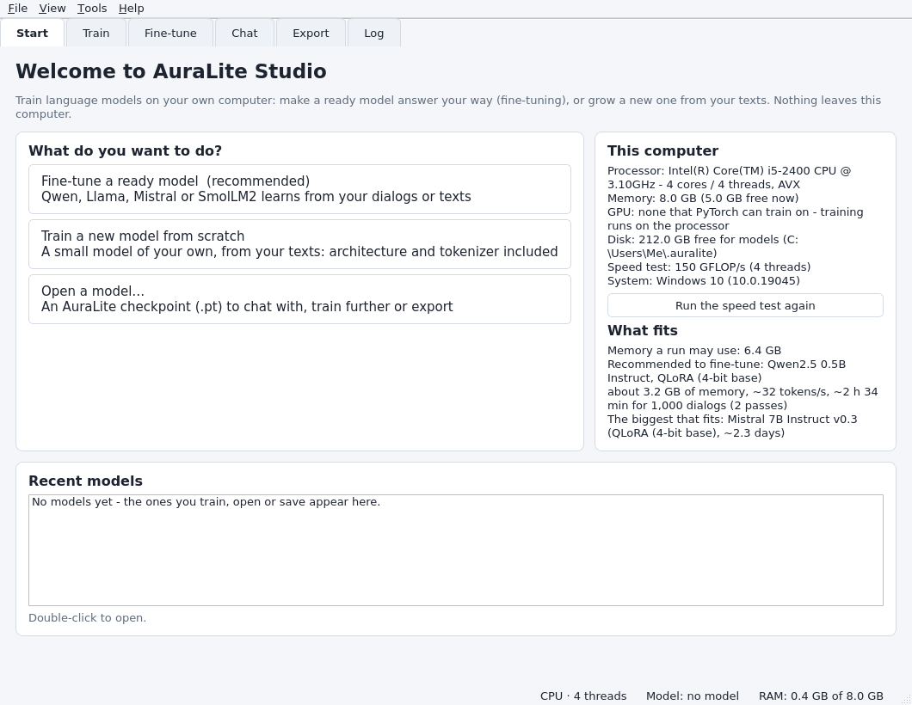
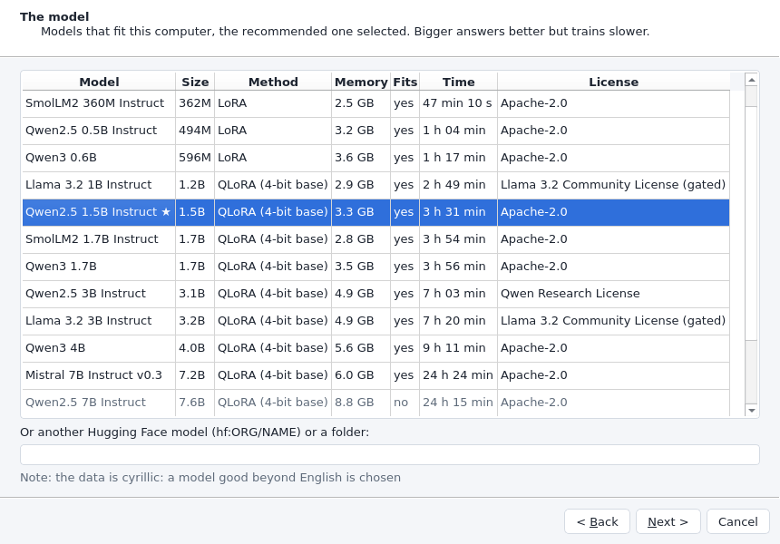
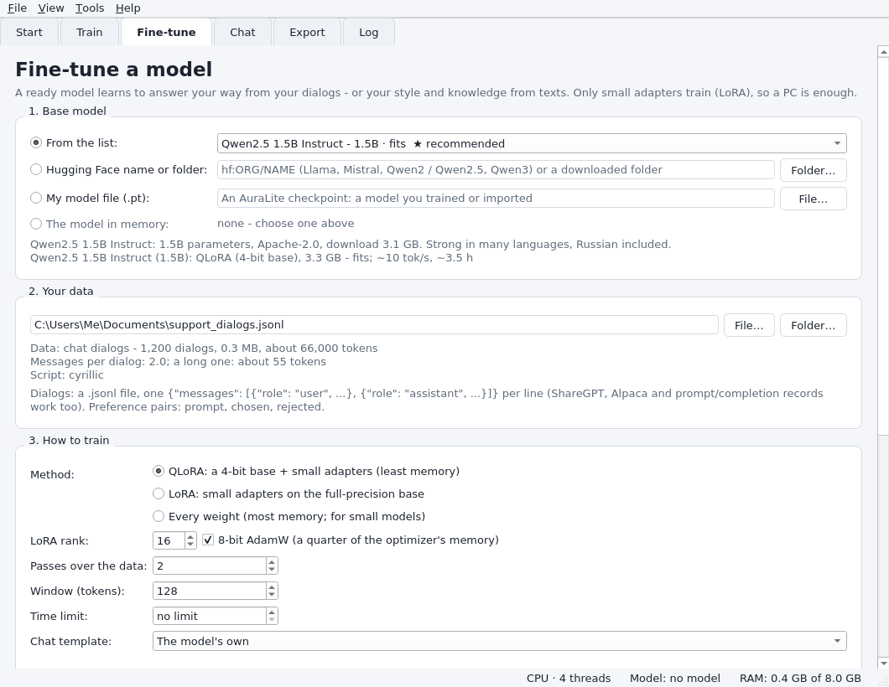

# AuraLite Studio — the desktop app

AuraLite Studio (2.19) is the desktop app for training language models on your own
computer: it looks at the machine, recommends a model and settings that fit it,
checks your data before anything trains, runs the training with a live chart, lets
you chat with the result and exports it for llama.cpp, Ollama, LM Studio or
transformers. Since 2.20 it keeps every run in a library — with its curve,
results and files — where a stopped or interrupted run continues where it stood. Nothing leaves your computer, except the download of a base model
from Hugging Face.



*The Start tab on a 4-core i5-2400 with 8 GB (the example computer of these
screenshots).*

Everything the classic interface (`auralite-gui`, tkinter) does is moving into the
Studio, in parts: since 2.24 its Train, Generate and Export tabs ([the Train tab's
expert settings](#everything-the-train-tab-sets-224), [the Generate
tab](#the-generate-tab-224)); quantization, evaluation and the Model tab (GGUF
models in chat, the transformers backend, the Hub) follow in 2.25, images and the
chat's agent mode in 2.26. Until then *Tools → Classic interface* opens it (in
AuraLite installed with Python; the Windows app leaves it out). The classic interface
stays and keeps being updated.

## Install and start

**Windows without Python (2.21):** download `AuraLite-Studio-<version>-windows-x64.zip`
from the [latest release](https://github.com/AlexanderNyr/AuraLite-AI/releases/latest),
unzip it and double-click `AuraLite Studio.exe` — Python, PyTorch and Qt are inside:
[docs/windows-app.md](windows-app.md). With Python, on any system:

```bash
pip install "auralite-ai[studio]"    # AuraLite + PySide6 (Qt 6 for Python)
auralite-studio                      # or: auralite studio, python -m auralite.studio
```

From a clone of the repository it is `pip install -e ".[studio]"` in its folder —
run it again after updating from an AuraLite older than 2.19, whose install has no
`auralite-studio` command yet.

On Windows `auralite-studio` starts without a console window (a shortcut can point
at `Scripts\auralite-studio.exe` of your Python or virtual environment). Without
PySide6 the command says how to install it instead of failing, and nothing else
that stops it passes in silence either: see [If the Studio does not
start](#if-the-studio-does-not-start).

**Requirements.** Python 3.11–3.14, Windows 10 (1809) or newer, Linux or macOS;
PySide6 6.9.3 or newer (the `studio` extra). Qt 6.10 and newer need a processor
with SSE4.2 and POPCNT (x86-64-v2): every Intel Core since 2008 (Nehalem; the
i5-2400 and i3-2100 qualify) and AMD since 2011 (Bulldozer). On an older processor
the Studio says so and how to install the last Qt that runs there
(`pip install "PySide6-Essentials<6.10"`, which gives 6.9.3); the classic interface
works anywhere. AVX2 is not needed: training uses what the processor has.

## The tabs

| tab | what it is for |
|---|---|
| **Start** | this computer (memory, processor, GPU, disk, a one-second speed test), the model that fits it best, recent models, and the three ways in: fine-tune a ready model, train a new one, open a model |
| **Train** | a new model from scratch, from your texts: the size (sized to the memory and the data) or a shape of your own, the tokenizer (or one of your own), the window, a time limit; a prepared dataset for big data, several computers, the model in memory trained further, settings files (2.24) |
| **Fine-tune** | everything for models that already exist: the base, your data, the method (QLoRA, LoRA, every weight), dialogs written by a teacher model, the LoRA adapters |
| **Chat** | talk to the model in memory, reply by reply as it writes; save the chat as a `.jsonl` dialog. A model trained on plain text continues what you write (*continue the text*, 2.21.3) |
| **Generate** (2.24) | the model writes on from a prompt with every sampling setting: temperature, top-k, top-p, min-p, the repetition penalty; several prompts in a batch, a draft first (thinking), web snippets as context; save, append or copy the text |
| **Export** | a GGUF file (llama.cpp, Ollama, LM Studio), a Hugging Face folder (transformers, vLLM) or an AuraLite checkpoint; since 2.24 also a PyTorch 2 program (`.pt2`), ONNX and TorchScript |
| **Library** (2.20) | every run with its curve, settings, results and files — continue a stopped or interrupted one, compare runs, evaluate a chat model; the models and datasets on the disk and the room they take |
| **Log** | everything AuraLite reports while it works, errors, warnings and epochs in their own colours (2.24); copy it, save it to a file (2.24) — the log file keeps it too |

The **setup wizard** (*Tools → Setup wizard*, and the first time the Studio starts)
asks what you want to do, looks at the computer, reads the data, shows the models
that fit with their memory and time, and fills in the tab — it can start the run
right away.



## Fine-tuning a ready model



1. **Base model.** *From the list* offers models AuraLite imports into its own
   engine: since 2.23 Qwen3.5 (0.8B, 2B, 4B, 9B) first, then the models before it
   (SmolLM2, Qwen2.5, Qwen3, Llama 3, Mistral) marked *(older)*; each is marked *fits*,
   *tight* or *too big* for this computer, the recommended one starred. *Hugging Face
   name or folder* takes any Qwen3.5, Llama, Mistral, Qwen2/2.5 or Qwen3 (`hf:ORG/NAME`,
   or a downloaded folder); *My model file* a checkpoint you trained or imported; *The
   model in memory* continues what is loaded.
2. **Your data.** A `.jsonl` file of dialogs — one `{"messages": [{"role": "user",
   "content": ...}, {"role": "assistant", "content": ...}]}` per line (ShareGPT,
   Alpaca and prompt/completion records work too) —, preference pairs (`prompt`,
   `chosen`, `rejected`: DPO or SimPO) or plain text (style and knowledge). The
   Studio reads it at once and says what it found: how many dialogs, about how
   many tokens, the language's script, records that would be skipped and why,
   too few examples.
3. **How to train.** *QLoRA* keeps the base in 4 bits and trains small adapters
   (least memory); *LoRA* trains the adapters on the full-precision base (a
   little better for small models); *Every weight* changes the whole model (most
   memory). The passes over the data and the window come from the data; the
   estimate under the form shows the memory and the time for the method chosen.
4. **Start.** The base is downloaded (resumable, checked against the Hub's
   sha256) and converted, then the run starts. *Finish* ends it well (the
   learning rate cools down, the model is kept); *Stop now* stops at the next
   step. Then: *Chat with it*, *Export…*, *Save the model…*, *Merge the adapters*.

**No dialogs yet?** *Let a bigger model write them*: a teacher (a GGUF file, a
llama.cpp server, a model folder or checkpoint — or the model in memory) answers a
file of questions; with a judge it keeps only right answers and also writes
preference pairs. The dialogs become the data of the next run.

Since 2.24, as in the classic interface: *Advanced settings → LoRA trains* every
projection, the attention only or the feed-forward layers only; preference pairs take
their own *beta* and *passes* (auto: beta 0.1 for DPO, 2.0 for SimPO; 3 passes); *Save
settings…* / *Load settings…* keep the whole form, the base and the data in a file.

## Everything the Train tab sets (2.24)

The Train tab starts simple — a size that fits, the tokenizer, the window, a time limit
— and since 2.24 also sets everything the classic interface's Train tab did:

- **A shape of your own.** *Model size → A shape of my own…* opens the shape, filled
  from the size chosen before: layers, width (`d_model`), heads, key/value heads
  (grouped-query attention; *one per head* is none), the feed-forward width. Options:
  ALiBi positions instead of rotary ones, QK-norm (on: steadier training), one table for
  the input and the output (older models' way), RoPE scaling (linear, NTK, YaRN — not a
  free longer context: train on longer windows to read further). The line under the size
  shows the parameters, the memory and the speed of the shape, as for the sizes.
- **The tokenizer.** BPE, characters, or *a tokenizer file of my own* (AuraLite's
  `.json`, a `tokenizer.json`, `vocab.json` with `merges.txt`, or a model's).
  *Train the tokenizer only…* learns it on the training text, saves it and selects it —
  one tokenizer for several models; *Save the model's tokenizer…* writes the one of the
  model in memory.
- **A prepared dataset.** *Prepare the dataset…* tokenizes the text into token shards on
  disk once (with the tokenizer chosen): big data then trains without reading the text
  again, *Stop* keeps what is done and preparing again continues it.
- **Passes.** *Suggest* picks the passes for about 20 tokens of text per parameter;
  *Patience* says after how many passes without progress the run stops.
- **The model in memory trained further** instead of a new one: it keeps its shape and
  tokenizer (the run in the library is "Train the model in memory on …").
- **Dialogs** (a chat model from scratch, from a `.jsonl`): the chat template, the
  prompt's weight in the loss, whole dialogs per window.
- **Advanced settings:** batches added up per step (accumulation), the learning-rate
  schedule (WSD or cosine), Muon's own learning rate, dropout (auto or a number),
  gradient clipping, `torch.compile`, every GPU of the computer (DDP, with two or more).
- **Several computers** ([training.md § 12](training.md#12-training-on-several-computers-214)): *Computers that help* and the
  port make this computer the main one, and say its address; on the others, *Help
  another computer* with that address and *Join* — they train a part of every step
  until *Leave*.
- **Settings files:** *Save settings…* / *Load settings…* keep the whole form and the
  data's path in a `.json` file.

## The Generate tab (2.24)

The classic interface's Generate tab: the model in memory writes on from a prompt.
*Sampling* has the temperature (lower: safer and more repetitive), top-k, top-p, min-p
and the repetition penalty (1.0 is off, 1.1–1.3 fights loops); *Suggest* picks a length
for the prompt and the model's context. *How*: the text as it is written or at once;
*one prompt per line* writes them all as one batch; *thinking* lets the model write a
draft first and the answer with it in view; *search the web* (DuckDuckGo) gives it the
snippets of a search as context (offline it writes without them); *the whole history*
lets every token see everything instead of the trained window (past the trained length
the text gets worse). The text can be saved, appended to a file or copied.

## Chatting with a model you trained from scratch (2.21.3)

A model trained on plain text — a story, your notes — has learned to write on from
where a text stops. It has never seen a dialog, nor the markers a chat template
wraps messages in (ChatML: `<|im_start|>user`), so a chat with it went nowhere:
its replies began in the middle of a word and ran to the token limit. The Chat
tab knows such a model and lets it **continue the text**: what you type is the
start of a text, and the reply is what the model writes after it (each message
starts anew; the system prompt has no part in it). The *Template* list says
*auto* for this — the model's own template, or continuing the text for a model of
plain text; *continue the text* forces it for any model, a template by name
forces that template. To get a model that answers, train or fine-tune it on
dialogs (`.jsonl`) — `auralite chat` says the same in a note.

What such a model writes depends on how much text it read. One story of about
85,000 characters (some 30,000 tokens) teaches a 7M-parameter model its words and
turns of phrase within minutes, then it learns the story by heart: validation
stops improving, early stopping keeps its best point, and what it writes reads
like the story only in snatches. The Train tab says so under the size when the
text is small for it, with how much text of the kind the size needs (about four
parameters per token: some 9 MB of such text for 7M parameters).

## Which model fits your computer

The Studio estimates the memory of a run with AuraLite's own estimate (within
about 20 % of measured peaks) and the speed from the one-second speed test: a
training step costs about 4 × the model's parameters in operations per token
with LoRA, 6 × with gradient checkpointing. It recommends the largest model that
fits the memory and finishes 1,000 dialogs (two passes) overnight — a Qwen3.5 when one
does (2.23), else the largest older model that does; for data that is not in English, a
multilingual model (Qwen). Measured on a 2-core CPU (2.18.1): Qwen2.5-0.5B with QLoRA
trained at 39 tokens/s in 1.48 GB.

| computer | recommended (2.24) | 1,000 dialogs, two passes |
|---|---|---|
| 4 GB, 4 threads | SmolLM2 135M (older), QLoRA | ~3 h |
| 8 GB, i5-2400 class | Qwen3.5 0.8B, QLoRA | ~7 h |
| 16 GB, i5-2400 class | Qwen3.5 0.8B, LoRA | ~7 h |
| 32 GB, 8 threads | Qwen3.5 2B, QLoRA | ~4.5 h |

(The i5-2400 class is 72 GFLOP/s, the 8-thread PC 300; the Studio measures yours, and
*Tools → Benchmark…* measures a real fine-tune. 2.24 calibrates the speed on the
benchmarks of the real i5-2400 — 50 % of the measured product speed instead of 45 % —
which brings Qwen3.5 0.8B within a night on 8 GB. There it fine-tuned with LoRA at 16
tokens/s, still faster than the advisor assumes: about 5 hours.)

**How fast is it really?** *Tools → Benchmark…* (2.22) trains three sizes of a new model
for a minute each and times how they write — the same as `auralite bench`; the report, a
Markdown table and JSON, goes to `~/.auralite/bench` ([benchmark.md](benchmark.md)). While
it runs, the menu item stops it. Since 2.23 a dialog comes first: the seconds per size
and, with *Also measure fine-tuning a model*, the model — from the catalog (Qwen3.5 0.8B
first) or **one already downloaded**: *Folder…* for a Hugging Face model's folder (with
`config.json`), *File…* for an AuraLite checkpoint (`.pt`, `.safetensors`) — and LoRA,
QLoRA or *Auto*. Start stays grey until the path is a model; the next benchmark opens
with the same choices.

The same check without the window: `auralite doctor [--data dialogs.jsonl]` prints
the computer, the models that fit and the `auralite train` command;
`--write-params plan.json` writes the settings for `--params`.

## The Library: runs, models, datasets (2.20)

Every training run is kept: the runs of the Train and Fine-tune tabs, and of
`auralite train` in a terminal. *Tools → Library* (Ctrl+L) opens them.

**Runs.** Each run has its name (*Fine-tune SmolLM2-135M-Instruct on
chats.jsonl* — rename it), its status, its curve (the training loss as a line,
the validation loss as dots, by step), the base model, the method, the data, the
settings, the losses, the steps, tokens and speed, its files and their size, and
your notes. The status says how it ended:

| status | what happened | what you can do |
|---|---|---|
| finished | the run ended: its epochs, its step or time budget, early stopping | *Open the result*, *Evaluate*, *Train more* (a new run from its result), *Repeat* |
| stopped | you pressed *Stop now* (*Finish* ends a run well instead: it is then finished) | **Continue** — and the rest |
| interrupted | the program or the computer stopped during the run: a crash, a power cut, the window closed | **Continue** from its last checkpoint |
| failed | an error ended it (the message is kept) | **Continue** from its last checkpoint, once the cause is fixed |

**Continue** goes on exactly where the run stood: the same order of batches,
learning-rate schedule, counters and random state — a stopped and continued run
ends with the same weights as one that never stopped (measured below). While a
run trains, the Studio saves its checkpoint **every 10 minutes**, and when you
stop it, into the run's folder; an interruption costs at most the last 10
minutes. When the Studio starts after an interrupted run, the Start tab offers
to continue it. A finished run keeps its model (`model.pt`, without the optimizer
state: smaller) and its checkpoint is deleted — it does not continue, *Train
more* trains its result further as a new run. Preference runs (DPO, SimPO) are
short and start anew. Continuing needs the same data: the run checks it and says
so if the file changed.

**Compare** (select two runs or more with Ctrl+click): their curves on one chart
and their settings and results side by side, what differs in bold.

**Evaluate** (a chat model): the run's result answers up to 30 of the dialogs its
run held out for validation — how often a reply stops by itself, how often it is
exactly the dialog's reply, the loss of the replies — and the run keeps the
numbers. The result is loaded for it, so you can chat with it afterwards.

**Models**: downloaded models (`~/.auralite/hf`), the results of runs, and the
models, LoRA adapters and exports (GGUF, Hugging Face folders) you saved — with
their size. *Chat with it*, *Fine-tune it*, *Export it*, *Show in folder*,
*Delete*: deleting a download or a run's files only frees room (a download comes
back on the next use); deleting one of your own files asks first.

**Datasets**: the data you checked or trained on (with what the check found and
how many runs used it), and the datasets `auralite data prepare` made
(`~/.auralite/datasets`). *Fine-tune on it*, *Train on it*, *Delete*.

The top line shows the room AuraLite's own files take (runs, downloads, prepared
data) and what is free on the disk.

**The measured run** (the 2 GB, 2-vCPU test machine, offscreen):
SmolLM2-135M-Instruct, QLoRA on 2,000 arithmetic dialogs, windows of 128 tokens,
batches of 2, 24 steps, each run in a fresh Studio from the same random start.
Run A trained straight through (66 s); run B was stopped at step 11 and
continued from the Library (32 s, then 43 s): **the two models are identical —
all 1,323 tensors, to the last bit** (training loss 0.2181 and validation loss
0.1186 for both). The stopped run's checkpoint took 192 MB, the finished model
181 MB (without the optimizer state); the Studio peaked at 1.4 GB.

In a terminal the same library is `auralite runs` ([docs/training.md §
22](training.md#22-the-run-library-and-continuing-any-run-220)).

## When something goes wrong

Errors are explained with what to try: *not enough memory* (QLoRA and 8-bit
AdamW, the memory plan, a shorter window, a smaller model), *the model needs your
permission* (gated models such as Llama: accept the license on huggingface.co and
set `HF_TOKEN`), *no connection* (the download continues where it stopped), *the
data cannot be used* (the formats), a missing optional package (the `pip install`
command). The details go to the log: *Tools → Open the log folder*
(`~/.auralite/logs/studio.log`, rolled over at 2 MB).

## If the Studio does not start

Since 2.19.1 whatever stops the Studio is shown in a message box — also when
`auralite-studio` runs without a console — and written to `~/.auralite/logs/`:

- `studio.log` — the app's log, with every error's traceback;
- `studio-output.log` — what it printed, when it was started without a console;
- `studio-faults.log` — Python's stack, if the process crashed inside Qt or
  PyTorch (the message box then says how it ended and shows the last lines).

`auralite doctor --studio` checks it in a fresh process — Python, the installed
package, Qt, on Windows the Visual C++ runtime, PyTorch, the processor —, builds
the window without showing it and prints what it found: `RESULT: OK` when the
window starts. If it says something else, that output is what an issue needs.
`python -m auralite.studio` starts the Studio in a console, where everything is
printed.

| What it says | What to do |
|---|---|
| `auralite-studio` *is not recognized as a command*, pip warns *auralite-ai 2.18.1 does not provide the extra 'studio'*, or `auralite doctor` says *the installed package is … but the code is …* | AuraLite was installed before 2.19 — an install from a folder (`pip install -e .`) keeps the metadata of its day. Install it again: `pip install -e ".[studio]"` in that folder, or `pip install -U "auralite-ai[studio]"` |
| *needs PySide6* | the command it shows — `python -m pip install "PySide6-Essentials>=6.9.3"` with the very Python AuraLite runs on |
| *no SSE4.2 / POPCNT*, or Qt's *Incompatible processor* | `pip install "PySide6-Essentials<6.10"` (Qt 6.9.3, the last for such processors) |
| *A library would not load*: `[WinError 1114] … c10.dll`, *DLL load failed* | install the latest [Microsoft Visual C++ Redistributable (x64)](https://aka.ms/vs/17/release/vc_redist.x64.exe), then `pip install -U "PySide6-Essentials>=6.9.3"` |
| *Could not find the Qt platform plugin "windows"* | `pip install --force-reinstall PySide6-Essentials`; remove a `QT_PLUGIN_PATH` variable another program set |
| *DLL load failed while importing QtCore* on Windows 7 or 8.1 | Qt 6 needs Windows 10: use the classic interface (`auralite-gui`) |

Why `WinError 1114`: PyTorch 2.9 and newer need Microsoft's C++ runtime
(`msvcp140.dll`) 14.40 or newer on Windows, PySide6 before 6.9.3 brings an older
copy, and the copy loaded first serves the whole process. The Studio loads the
newest copy on the computer before Qt and PyTorch, and the `studio` extra installs
PySide6 6.9.3 or newer.

## Files

Everything lives in `~/.auralite` (`AURALITE_HOME`): downloaded models (`hf/`),
the runs (`runs/<id>/`: `run.json`, `metrics.jsonl`, `checkpoint.pt`, `model.pt`),
prepared datasets (`datasets/`), what the Library remembers (`library.json`: the
models and data you saved, exported or checked), the Studio's settings
(`studio.json`: theme, recent models, the last speed test — never a token), logs
(`logs/`: `studio.log`, `studio-output.log`, `studio-faults.log`). *Help → Check
for updates* asks PyPI for a newer version; nothing is installed by itself.
